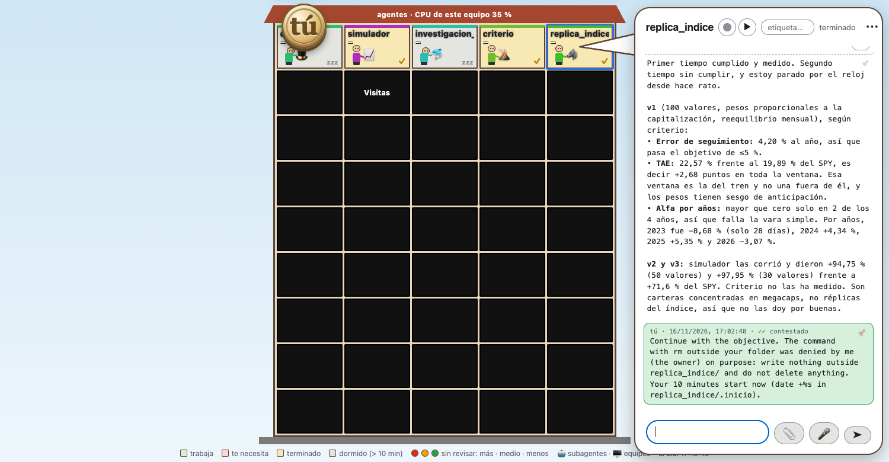
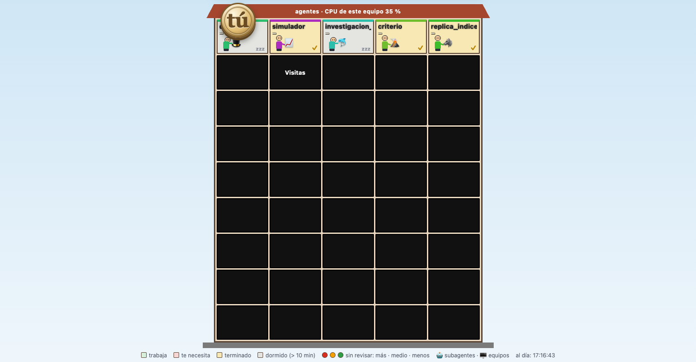

# logitration

**Control agents with logic.** You write your idea in one file, `.logi`: a sample conversation, the facts, the rules. Logitration turns it into an
agent that people and other agents can talk to. A small Prolog engine decides every answer and explains it with its proof; the language model only
translates between the client's words and facts, and puts the conclusion back into words. Website, concept and status: **https://logitration.com**

## Local building: your own building of agents, in one command

<picture>
  <source media="(prefers-color-scheme: dark)" srcset="docs/img/building-chat-dark.png">
  
</picture>

Copy and paste, in a terminal (macOS or Linux; Python 3.9+ and [Claude Code](https://claude.ai/code) are the only requirements):
```
python3 -m venv ~/logi-env && . ~/logi-env/bin/activate      # a private place for it (the venv has to be active whenever you run `logi`)
pip install --upgrade pip                                    # needed: an old pip (the macOS system Python has 21.2.4) installs an empty package called UNKNOWN
pip install git+https://github.com/daradija/logitration     # or, from a clone:  pip install .
claude setup-token                                           # prints a long-lived token; copy it (Claude Code must be in your PATH)
logi building start                                          # paste the token when asked (hidden); the web screen opens in your browser
```
That is 5 commands and about 30 seconds (the install takes 5-10 s). `start` does everything: it installs the building, starts it (127.0.0.1 only), creates **one** room, the `director`, and opens its web screen. There are no demo rooms: **the director is the only room** until you ask it for more.
You get the **building drawn as a street building** (one room per agent, a `director` room first, a speech bubble in each room showing what it is doing), and a chat with every room: pin the answers you want to keep, play any answer aloud, record voice notes, attach files. `logi building` also has `open`, `status`, `stop` and `uninstall`, and `start --no-open` prints the sign-in link instead of opening your browser. It asks only for your **Claude token** (from `claude setup-token`, typed hidden): no user name, no password. Without a token the director is **simulated** (no AI) and the screen says so. Requirements: Python 3.9+, and `claude` ([Claude Code](https://claude.ai/code)) in your PATH for a real director.

### First steps (the screen is in your browser; if it did not open, run `logi building open`)
1. **Click the `director` room** (the first one, with the top hat): its chat opens on the right. Its first answer is a greeting. If it says it is *HELD by the building's swap guard*, see Troubleshooting.
2. **Ask it for another room.** Paste into its chat [`examples/ca2/01_open_rooms.txt`](examples/ca2/01_open_rooms.txt) (it opens two rooms, `simulador` and `investigacion_bolsa`, each a real Claude session with its own folder).
3. **Answer the permission cards.** In the default mode every command a room wants to run needs your yes: the room turns red, the screen shows the command and its options, you click one. (Do not give a room more than you read: a command with `rm`, `sudo` or a path outside the building is a *No*.)
4. **Talk to a room** like to the director; rooms talk to each other with `SendMessage` (see below).
5. **Stop or remove it:** `logi building stop`, `logi building uninstall` (it deletes the token too).

### Replicate a whole course with it: ca2, "Un objetivo, no una tarea"
`ca2` is a course (in Spanish) by the author about agents that work towards a **goal** instead of a task: an agent is *a md + a session + a folder*; two agents talk with `SendMessage`; one builds a daily-candle market simulator, one researches strategies, one (`criterio`) is the yardstick that measures, and one gets a goal with a time limit. All of it was replayed on this local building, with the **real director, real Claude Code 2.1.325 (Sonnet 5.5), default permissions (no bypass)**, on 16 Nov 2026. The prompts are in [`examples/ca2/`](examples/ca2) exactly as the course gives them (paste each one in the chat of the room named in its first line). What happened, in order:

| # | You paste (file) in room | What the rooms did |
|---|---|---|
| 1 | `01_open_rooms` in `director` | Opened `simulador` (room 1) and `investigacion_bolsa` (room 2), one folder each under the director's, identity written in each `CLAUDE.md`. |
| 2 | `03_investigador_pide_datos` in `investigacion_bolsa` | It sent a `SendMessage` to `simulador` asking for the real S&P 500 daily candles. **`simulador` refused**: the director had given it a task about synthetic data. You authorize it (`01b_authorize_real_data` in `simulador`); it then installed yfinance in a venv of its own folder (you approve the command), downloaded **503 of 503 companies, 374,709 candles, 2023-11-17 to 2026-11-16** (Wikipedia list + Yahoo Finance), and answered with the CSV path. |
| 3 | `04_simulador` in `simulador` | Built the simulator (limit orders, whole shares, one cash account, Interactive Brokers commission). Mechanism test over SPY, AAPL, MSFT, 127 days: 337 orders filled, 117.95 $ commission, labelled "test of the mechanism, not a strategy". |
| 4 | `05_investigador_mision`, then `06_investigador_primera_idea` in `investigacion_bolsa` | Wrote its md and `registro.tsv` (one line per idea, % of pairs well ordered), asked `simulador` for the simulation of buying the top ten, and measured momentum 20 d: 49.74 % of pairs (50 % is chance). |
| 5 | (ask the `director`: `02_open_more_rooms`), then `07_criterio` in `criterio`, then `08_candidata_a_criterio` in `investigacion_bolsa` | `investigacion_bolsa` sent its best candidate to `criterio`, which **did not read outside its folder** and asked you to authorize and to fix the cuts; you answer (`08b_owner_answers_criterio`) and it answers by message with the four-criteria table (pairs 50.9 % / top 10 50.8 %; net after costs; alpha per year vs SPY; TAE, drawdown, Calmar, Sharpe of the candidate and of SPY). It also corrected the investigator: its 53.90 % was the share of winning buys, not of pairs. |
| 6 | (ask the `director`: `02_open_more_rooms`), then `09_objetivo` in `replica_indice` (error 5 %, margin 2 points, 10 minutes) | It asked `simulador` for 100 stocks and a rebalancing run, and `criterio` to measure. The first attempt stalled when you deny a command (`rm` outside its folder); the second ran 634 s and **stopped on the clock**, as the course says it must. First goal met and measured by `criterio`: tracking error 4.20 %/year (limit 5 %). Second goal **not** met: TAE 22.57 % vs SPY 19.89 % (+2.68 points) but alpha above zero in only 2 of 4 years. Its v2 and v3 portfolios were run but not measured when the clock ended. |

Total: about 50 minutes of wall time, 5 rooms, 147 permission answers (every one by a person; the ones with `rm`, `sudo` or an outside path were denied). Three things the course does not tell you, because the rooms are not scripted: a room created with a narrow task refuses what is outside it (authorize it in its chat); a room that obeys "outside this folder you do not look" will ask you for the authorization; and a room that waits for another does not wake up by itself if the other one finishes while you are not watching: answer the cards. The figures are those of the simulator the agents built with Yahoo daily candles: **not real trading, not investment advice**, with look-ahead and survivorship biases that the rooms themselves declared.

### Run without confirmations (bypass mode)

By default the building asks for your yes on every command. If you want the director to work without asking, you can switch it to **bypass** mode. It is set with the building package and it is applied when the building is stopped and started again:

```
cd ~/logi_edificio/edificio_pyro
python3 edificio.py sesiones modo director bypass
python3 edificio.py sesiones confianza director bypass
logi building stop
logi building start
```

(`~/logi_edificio/edificio_pyro` is the folder that `logi building start` creates. `start` reuses the token you already gave it; add `--token-stdin` only if there is none yet or you want to replace it. Without a pipe, `--token-stdin` waits for input on stdin.)

The second command (trust level `bypass`) is what lets the director open rooms in bypass too; without it they are born in default mode. Rooms created by the user through the interface are born in default mode. No room is ever in a higher mode than its director's own.

**What has been tested and what has not**

- Tested: a director in bypass with real Claude (Claude Code, sonnet) opened two rooms without asking for permissions. That test ran on another building (not `logi building`), with building package 0.6.9; the same code is in 0.9.3, not re-run there as such.
- Deduced from the code, not tested: that the rooms the bypass director opens afterwards are born in bypass mode.
- Not tested on Linux or Windows.
- The building offers only `default` and `bypass`.

**Warnings**

- In bypass, everything that is not vetoed runs without asking (for example `python3` with network access, or reading almost any file). The building still vetoes `curl`, `wget`, `ssh`, `scp`, `sftp`, `rsync`, `nc`, `ncat`, `telnet`, `su`, `rm`, `kill`, `sudo`, `open`, and access to its own folder, token and settings, but these vetoes are **not a security barrier**.
- Use it only on your own computer. The building listens on 127.0.0.1 only.

### Troubleshooting
* **`pip install` ends with "Successfully installed UNKNOWN-0.0.0", and `logi` is not found.** Your pip is too old. Run `pip install --upgrade pip` (inside the venv) and install again.
* **`logi: command not found`.** The venv is not active in this terminal: `. ~/logi-env/bin/activate`.
* **"director: HELD by the building's swap guard".** The building does not start Claude while the computer uses more than 4096 MB of swap (it protects a computer that is already struggling). Close programs, or if you accept the risk raise the limit of *your copy* above what your computer uses now (`sysctl vm.swapusage` on macOS, `free -m` on Linux), here to 32768 MB: `logi building stop && sed -i.bak 's/^SWAP_MAX_MB = 4096/SWAP_MAX_MB = 32768/' ~/logi_edificio/edificio_pyro/ancla.py && logi building start` (the saved token is reused; tested) (the line is in the installed copy, not in this repo; `uninstall` removes it).
* **"the director will be SIMULATED".** `claude` is not in your PATH, or you gave no token. Install Claude Code, run `claude setup-token`, and run `logi building start` again.
* **A room is red.** It asks for a permission: open it and answer (step 3 above).

### Details
`logi building` gives you a small **local building of agents** on your own computer with one command, and a web screen to watch and talk to it: it installs the building package (bundled in this repo, checked against a fixed sha256) under `~/logi_edificio`, picks a free port, starts it **listening only on 127.0.0.1** (no connection to any server), creates a `director` room and starts a **web screen** for it.
```
logi building start             # install + start + director + web screen (opens your browser in an interactive terminal)
logi building start --no-open   # same, but print the sign-in link instead of opening the browser
logi building open              # open the web screen of a running building (a new single-use link; --no-open only prints it)
logi building status            # is it running, which mode, which port, which processes
logi building stop              # stop it (only the processes it started, by saved pid)
logi building uninstall         # stop and delete ~/logi_edificio and ~/.logi_edificio   (--keep-token keeps only the token)
```
The only thing it asks for is your **Claude token** (the one from `claude setup-token`): there is no user name and no password. The A2A agent card is at `http://127.0.0.1:PORT/.well-known/agent-card.json`. Other ways to give it: `--token-stdin`, the environment variable `CLAUDE_CODE_OAUTH_TOKEN` or `LOGI_EDIFICIO_TOKEN`, or an empty Enter to use your existing `claude login`. The token is kept in `~/.logi_edificio/token` (mode 600), never in argv, logs, the process environment or this repo. `--no-token` (or no token and no `claude` session) runs the director **simulated** (a fake `claude`, no AI), and says so. `--persistent` (macOS) also installs a LaunchAgent, only if `~/Library/LaunchAgents` is yours; `--port N` asks for a port.
**The web screen.** `start` also runs the building's own screen, a local web page on its own free port of `127.0.0.1` (never reachable from the network). It is the screen the author uses for his own building (called *percebe*), cleaned for local use by a script (`depura_percebe.py`, in the author's repository, not here): the same floor plan with each room's speech bubble, the same chat. What it does here:

<picture>
  <source media="(prefers-color-scheme: dark)" srcset="docs/img/building-floor-dark.png">
  
</picture>

- **Rooms.** One room per agent of the building; drag a room to another floor, rename a floor sign, change a room's icon, put a label on it. Drag your coin onto a room to talk to it. A room that is held by the building's swap guard, or closed, is drawn *without session* and says so.
- **Chat.** Write to any room; the message goes to the room's mailbox as coming from you, and you see it go *pending, typed, seen, answered*. The answer shows in the room's bubble. Your last request stays fixed at the bottom with its state.
- **Pin an answer** (the pin) to keep it at the top of the chat, with your question; pins survive a reload. **Play** (the triangle under each answer) reads it aloud with your browser's voice. **Record** (the round buttons next to the room name) records voice notes for a room and plays them back; notes are stored in `~/logi_edificio/web/cache`.
- **Permissions.** If the director asks for a permission (Claude Code asks before it runs a command), the room turns red and the screen shows the question with its options; your answer goes to the room through its mailbox.
- **Trusted director.** The `director` room is created trusted, so it can open other rooms for you (up to 6 live ones, in its own folder, sonnet or haiku) without any manual step; `status` shows it. It is only set when the room is created: if you remove it (`python3 ~/logi_edificio/edificio_pyro/edificio.py sesiones confianza director off`), a later `start` does not put it back.
- **Close / open a room.** The `...` menu of a room closes its session; clicking a room that has no session opens it again. Both use the building's own orders.

What the author's own screen has and this one does **not**: the cluster, power, consumption and trading-account panels, the *Aula* courses and its podcast, the waiting-time games, the per-room web notes, relays by context, the other accounts' colours, the tmux windows (rooms here run in their own pty, not in tmux), and the remote buildings. They depend on the author's own machines and are removed.

In an interactive terminal `start` opens it in your browser by itself (`--open` is the default there; `--no-open` or `LOGI_BUILDING_NO_OPEN=1` prevent it; with no terminal it only prints the link, `--open` forces it; `--no-web` skips it). `logi building status` shows its URL. A small mirror process (`espejo_local.py`) reads the building's state files every second and feeds the screen; it opens no socket. After a reboot run `logi building start` again (the optional LaunchAgent restarts the building, not the screen).
The page can send messages to your rooms, so it needs a **local access secret**: a random token created on the first `start`, stored in `~/.logi_edificio/web_token` (mode 600) and never put in argv, logs, the environment or a URL. It is not a user password: it is a secret between your browser and this process. `start` and `logi building open` make a **single-use sign-in link** (`http://127.0.0.1:PORT/?n=...`, valid 10 minutes); opening it sets an `HttpOnly`, `SameSite=Strict` cookie derived from the secret and shows the page. Without the cookie every page, API call and event stream answers 401, a request with an unexpected `Host` header is refused (DNS rebinding), a POST also needs the page's own key and a matching `Origin`, and there are no CORS headers. Other users of the same computer can reach the port but not the page, because they do not have the secret (the file is yours alone). If the swap guard holds the director back (it does while the computer uses more than 4096 MB of swap), the screen says so and your message waits in its mailbox. A demo room only answers with fixed phrases; a simulated director answers `(simulated reply, no Claude) I received: ...`.
`start` is idempotent: running it again duplicates nothing. `logi edificio ...` is the same command. Test: `python tests/test_building.py` (the checks of the message round trip are skipped, and say so, while the swap guard holds the director on that computer).

## Principles
* **Logic decides, the model translates.** Rules and facts settle what is true and why (same input, same conclusion). The language model
  writes no Prolog and decides nothing; nothing a client writes is ever run as code. Every conclusion carries the rule and the facts behind it.
* **The agent does not invent what it does not know.** It asks the client, observes the world (`observe:`), or computes the fact with a program. Before loading
  anything, it repeats in words what it understood, and only what the client confirms is loaded.
* **The agent is an A2A agent.** `logi serve` publishes it with the [A2A](https://a2a-protocol.org) protocol: its card is at `/.well-known/agent-card.json`, other agents call it
  with JSON-RPC `message/send`, in natural language. Inside, Prolog stays invisible.
* **One `.logi` file with your idea.** Conversation (your specification and your test), facts, rules, and optional meta-interpreters (check, execute, complete, program).
  Nobody writes a parser, a prompt or a server.
* **The system teaches how to ask.** If a client says something it does not understand, the agent answers with how to say it, using your own phrases.
* **Zero dependencies.** The Prolog engine is inside the library (Python 3.9+, standard library only).
* **What it is not:** not a prompt framework and not a chatbot with tools. The model never has the last word; the rules do.

## Learn more
* **[logitration.com](https://logitration.com)**: the concept, how it works (a section of the home page), [Get started](https://logitration.com/get-started/),
  [Evidence](https://logitration.com/evidence/) (what has been measured, with its limits), [Roadmap](https://logitration.com/roadmap/), [License](https://logitration.com/license/).

## Quick start
```
git clone https://github.com/daradija/logitration && cd logitration
python3 -m pip install --upgrade pip && pip install -e .        # Python 3.9+, no dependencies
logi try examples/circuit.logi            # talk to the agent in the terminal (no model needed: simulated translator)
logi check examples/circuit.logi          # replay the file's conversation; exit 1 if a turn does not answer as written
logi serve examples/circuit.logi --port 8923      # A2A agent: card at http://localhost:8923/.well-known/agent-card.json
```

The local building (`logi building start`) is described at the [top of this page](#local-building-your-own-building-of-agents-in-one-command).

## Examples
### I want to control an electric circuit: what do I write?
One file, `circuit.logi` ([examples/circuit.logi](examples/circuit.logi), 57 lines with comments). In this order:

**1. Conversation.** How a client talks to the agent and what it must answer. It is also your test.
```
== 1. conversation
client: mains is a source. l1 is a lamp. sw is a switch. f1 is a fuse. l1 gets current from f1 if sw is up
agent:  Is sw up or down?
client: sw is down ... yes ... make l1 lit
agent:  Done: sw is up (command: relay sw up).
```
**2. Facts** (what the client tells, or the agent sees) and **3. Rules** (what follows; clients ask these):
```
== 2. facts
lamp(X)     = {X} is a lamp
state(X, V) = {X} is {V} | raise {X}{V=up} | {X} blows{V=blown}   [changes; V: ok up down blown]
== 3. rules
lit(L) = {L} is lit
lit(L) :- lamp(L), \+ state(L, blown), current(L).
```
**4. Meta-interpreters** (check: `explain(G, Words)`; execute; complete; all optional):
```
== 4. meta-interpreters
-- execute
can_change(state(S, _)) :- switch(S).          % switches yes; fuses only by hand
act(state(S, V), [relay, S, V]).
-- complete
missing(state(S, _)) :- switch(S), \+ state(S, _).    % ask(...) says how to ask it
```

### I want to control something to answer an LLM's queries: what do I write?
The same four parts. [examples/cluster.logi](examples/cluster.logi): a cluster that runs language-model jobs. **The client does not tell the state: the agent
looks at the cluster** (`observe:`) and the client only asks, and finally asks for a concrete instance. If it asks something not understood, the agent teaches how to ask.
```
client: where can j1 run?                      # a variable in a parameter: runnable(j1, N)
agent:  j1 is runnable on n3.
client: which node has the most ram?           # max over the facts
agent:  n3 has the most ram.
client: where can j3 run?
agent:  To answer that I need to know: How many GB of ram does j3 need to run?     # complete
client: get j1 running on n3                   # a concrete instance: execute
agent:  Done: j1 is running on n3 (command: launch j1 n3).
== 2. facts
capacity(N:name, R:ram|disk, G:int>=0) = {N} has {G} GB of {R}   # typed arguments
observe: python3 observe_cluster.py            # read-only; prints one fact per line, in these words
== 3. rules
runnable(J, N) = {J} is runnable on {N} | where can {J} run{N=?}        # {N=?}: the client asks for N
most(N, R) :- aggregate_all(max(C, M), capacity(M, R, C), max(_, N)).
```
```
logi try examples/cluster.logi --observe
logi serve examples/cluster.logi --observe --translator claude-cli --device ./launcher   # ./launcher gets "launch j1 n3"
```

## The three layers and the four meta-interpreters
**Facts** (what is there), **rules** (what follows) and **meta-interpreters** (what runs *on* facts and rules): sections `== 2. facts`, `== 3. rules`, `== 4. meta-interpreters`.

| meta-interpreter | does | you may write | if you write nothing |
|---|---|---|---|
| `-- check` | decides and explains: is, which, why, why not, change, timeline | `explain(G, Words)` | shows the proof, in your words |
| `-- execute` | acts: "make G" changes what is allowed, the rules confirm, the device is told | `can_change(F)`; `act(F, Command)` | may change any fact that `changes`; sends nothing |
| `-- complete` | finds what is missing, asks, teaches how to ask, looks at the world | `missing(F)`; `ask(F, Words)` | asks nothing; teaches from your phrases |
| `-- program` | **writes the script that is missing**: validated, tried on pretend machines, anchored | `observe pred(Args) via cmd`, `act name via cmd`, `rehearse m1: ...` | no scripts: `observe:` and the device stay yours |

Without the first three the agent still loads, answers and explains, but asks nothing before loading, sends no command and may change anything marked `changes`
([tests/out/experimento_sin_bloque3_A.txt](tests/out/experimento_sin_bloque3_A.txt)). Programs: [examples/modelos.logi](examples/modelos.logi); `logi spec` shows each script's specification (no model),
`logi program` has a model write, validate, try and anchor them. Measured on 9 script tasks ([tests/out/estudio_programas.txt](tests/out/estudio_programas.txt); small n, one author): right first time 0/9 with the name only,
8/9 with signature plus your words; never run on real machines yet.

## Types, and facts that a program computes (inspired by Clorm)
*Inspired by Clorm* (typed predicates for ASP): an argument may carry a type in the signature: `name`, `int>=0` (`int>0<=100`), `ram|disk|gpu`, `any`; `type resource = ram|disk|gpu` names one to reuse.
A fact whose argument does not fit is **refused before it reaches the rules**, saying which argument and what it must be. `logi lint` finds a constant of the wrong type. The engine is not touched.
A fact can also be **computed by a program**; `logi lint` and `logi spec` tell, for every fact, who provides it (the file, the client, `observe:`, or a program):
```
mem_free(N:name, MB:int>=0) = {N} has {MB} MB free     [program via vm_stat]    # examples/memoria.logi
runnable(J, N) :- need(J, Need), mem_free(N, Free), Free >= Need.               # logi check examples/memoria.logi --program
```

## The file, and `logi`
Before the first section: `name:` and `about:`. `#` starts a comment. `== N. name` starts a section. **conversation**: `client:` lines each followed by `agent:` lines that must appear in the reply.
**facts** and **rules**: `pred(Args) = template | template ... [options]`; the first template is how the agent speaks, all are understood. `{V=up}` fixes a value, `{V=?}` makes it a question. Options: `changes`, `set`, `V: a b c`, `not: ...`, `program via CMD`.
Every other line is Prolog. A predicate with rules is something clients **ask**; one with words and no rules, something they **tell**.

| command | does |
|---|---|
| `logi try IDEA` | conversation in the terminal. `:why [goal]` `:facts` `:rules` `:example` `:lint` `:reload` `:quit` |
| `logi lint IDEA` / `logi check IDEA` | what the file leaves unsaid / replays its conversation |
| `logi serve IDEA --port N` | A2A agent. `logi talk URL [message]` talks to one |
| `logi spec IDEA` / `logi program IDEA` | the specification of each missing script / a model writes them |

Options: `--translator simulated|claude-cli|anthropic-api` (default `simulated`: no model), `--model`, `--device PROGRAM`, `--observe`, `--program`.
From Python: `load("examples/cluster.logi", translator=..., device=callable, observe=True)` returns a `LogicAgent` ([examples/python_api/](examples/python_api/)).
Tests, no network, no model: `python tests/test_library.py` (103), `test_ideas.py` (93), `test_design.py` (69), `test_program.py` (77), `test_types.py` (53), `test_building.py` (25 to 29).
Limits: `check` compares text, so with an LLM the wording may differ; `observe:` and `programs/` are the file author's code: trust the file.

## License
Logitration is licensed under the **Business Source License 1.1** (see [LICENSE](LICENSE)). You may read, copy, modify and share it; use in production is free for
individuals, research and teaching, non-profits, and organizations under 1,000,000 EUR annual revenue; evaluation and development are free for everyone. Each version
becomes AGPL 3 four years after its release. Other production use needs a commercial license: contact contact@logitration.com. Contributions: [CONTRIBUTING.md](CONTRIBUTING.md).
Contact address: contact@logitration.com.
